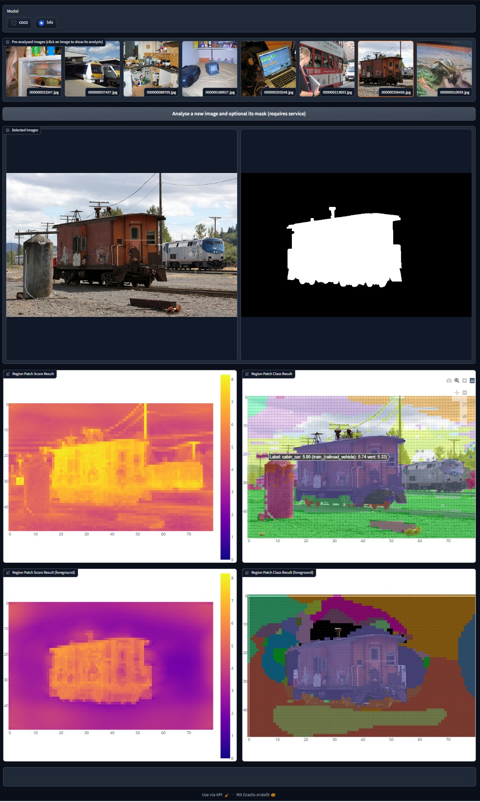
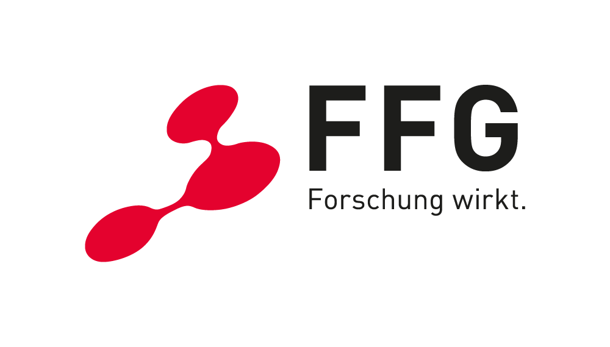

# FSOD-Visual-Explanations

Web application for visual explanations of a few-shot object detection model (DE-ViT with DINOv3 features).

## Description

The application visualises how the object detection model classifies the image patches of a query image, as well as showing the influence of the background on these classifications:

| Figure | Content |
|---|---|
| Region Patch Score Result | Heatmap of the classification score of the best class of every patch |
| Region Patch Class Result | The best class of every patch, drawn over the image (hover to see the top classes and scores) |
| ... (foreground) | The same two figures for the foreground only, if a mask image is given. Both heatmaps use the same color scale, so the scores are comparable |

Two models can be selected: `coco` and `lvis`.

<p align="center">
  
</p>

The application has two modes:

* **Pre-analysed images**: A gallery shows all images with a saved analysis result. A click on a thumbnail creates the
  figures from the saved result. The object detection service is **not** needed.
* **New images**: An uploaded image (and optional its mask) is analysed by the object detection service. The image, the
  mask and the result are saved, so that the image appears in the gallery afterwards. The service is **required**.

### Project files

| File | Purpose |
|---|---|
| `web_gui_explainability.py` | The web application (Gradio) |
| `object_detection_client.py` | Client of the object detection service |
| `service_settings.py` | Settings of the service client |
| `explainability_util.py` | Creation of the plotly figures (imported by the application, see Installation) |
| `coco\`, `lvis\` | Data folders with the demo images and saved results |

### Data layout

Below `--data_dir` (default: the current directory) there is one folder per model:

```
<data_dir>\coco\images\    query images and optional mask images (<name>.mask.png)
<data_dir>\coco\results\   saved results (<image file name>.npz), label list (labels.json)
<data_dir>\lvis\images\
<data_dir>\lvis\results\
```

A mask image belongs to an image of the same name and its file name must end with `mask.png`
(e.g. `000000000785.jpg` and `000000000785.mask.png`).

## Installation

### Prerequisites

* Python 3.10 or newer
* For new images only: a running object detection service (default `localhost:8001`) providing the models
  `default_coco_dinov3` and `default_lvis_dinov3`

### Steps

1. Get the code and change into the project folder.

2. Create and activate a virtual environment (optional):

   ```
   python -m venv venv
   venv\Scripts\activate
   ```

3. Install the dependencies:

   ```
   pip install gradio plotly numpy opencv-python requests pydantic-settings
   ```

## User manual

### Start

```
python web_gui_explainability.py
```

Then open <http://localhost:8003> in a browser.

Command line options:

| Option | Default | Description |
|---|---|---|
| `--service_url` | `localhost` | Host of the object detection service |
| `--service_port` | `8001` | Port of the object detection service |
| `--port` | `8003` | Port of the web user interface |
| `--data_dir` | `.` | Folder containing the folders `coco` and `lvis` |
| `--coco_model_id` | `default_coco_dinov3` | Model id used for `coco` |
| `--lvis_model_id` | `default_lvis_dinov3` | Model id used for `lvis` |

Example with a remote service:

```
python web_gui_explainability.py --service_url 192.168.0.10 --service_port 8001 --data_dir D:\data
```

### Usage

1. **Select the model** (`coco` or `lvis`). The gallery shows the pre-analysed images of this model. If the service
   is not reachable, a red message appears in the status line; the pre-analysed images can still be used.
2. **View a pre-analysed image**: click a thumbnail. The selected image (and its mask) and the figures are shown.
   Hover over the figures to see the classes and scores of a patch.
3. **Analyse a new image** (service required): click the upload button and select an image, optionally together with
   its mask image (file name ends with `mask.png`, white (255) = foreground). Select exactly one image and at most one mask.
   After the analysis the figures are shown and the image is added to the gallery.

### Troubleshooting

| Message | Solution |
|---|---|
| `The object detection service is not available...` | Start the service or check `--service_url` / `--service_port`; use pre-analysed images meanwhile |
| `No label list available...` | No service and no `results\labels.json`; start the service once to create it |
| `Please select an image and optional its mask image...` | Select one image and at most one `*mask.png` file |
| `ModuleNotFoundError: explainability_util` | Copy `explainability_util.py` into the application folder |

## License

See [LICENSE](LICENSE).

## Acknowledgement

This work is a result of the project FAIR-AI, which is funded by the Austrian Research Promotion Agency (FFG) as part of Artificial Intelligence Mission Austria (AIM AT) from funds of the Austrian Federal Ministry of Innovation, Mobility, and Infrastructure.

<p align="center">
  
  
  
</p>
